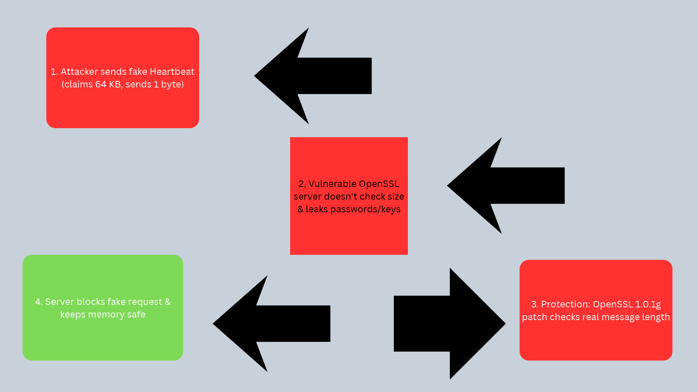

# Heartbleed & Open-Source Security

## Introduction
This site covers the Heartbleed vulnerability (CVE-2014-0160) and the ethics of responsible vulnerability disclosure. Heartbleed was a critical flaw in the OpenSSL encryption library that allowed attackers to secretly read private server memory across millions of websites. Both topics matter to everyday students, families, and businesses because online banking, email, and logins depend on encrypted connections. When critical software has unpatched flaws or disclosures are mishandled, everyone's personal data is put at risk.
Key idea in one sentence: A single missing bounds check in widely used encryption software exposed millions of users' private data, showing why timely patching, key replacement, and ethical disclosure are essential to internet safety.
## The ethics
Ethics topic: Responsible Disclosure & Open-Source Accountability

The ethical question: When a researcher finds a severe security bug in free, widely used software, should they report it privately so developers can build a fix first, or announce it immediately so users know they are at risk?

Who is helped and who is harmed?
Who is helped: Everyday internet users and businesses are helped when a patch is prepared before public release, preventing mass exploitation before a fix exists.
Who is harmed: Users remain exposed during any disclosure delay if attackers already discovered the bug silently, or if maintainers take too long to release an update.
Other people or groups affected: Volunteer open-source developers, Certificate Authorities, and public agencies that depend on OpenSSL.
What the law or a professional code says
The ACM Code of Ethics (Section 1.2: Avoid Harm) states that computing professionals must prevent negative consequences and alert stakeholders to system risks. Likewise, the (ISC)² Code of Ethics requires professionals to protect society, the common good, and critical infrastructure. Coordinated disclosure follows both codes by giving maintainers a short, private window to build a fix before warning the public.
## Real-world example
In April 2014, researchers at Google Security and Codenomicon independently discovered Heartbleed and privately alerted the OpenSSL team before publicly disclosing the bug on April 7, 2014, alongside the patched OpenSSL 1.0.1g release.
## My position
Researchers should practice coordinated disclosure by giving maintainers a strict, limited window to create a patch before going public. First, releasing exploit details without a patch hands attackers a weapon before defenders have a shield. Second, a brief private window ensures a tested update is ready the moment the public is warned.
## Memory Safety & Buffer Over-Reads
• How C/C++ manual memory management leads to out-of-bounds reads, contrasting Heartbleed (over-read) with traditional buffer overflows (over-write).
 How C/C++ manual memory management leads to out-of-bounds reads, contrasting Heartbleed (over-read) with traditional buffer overflows (over-write).
 ## Key & Certificate Lifecycle
 • Private key extraction, certificate revocation (CRL/OCSP), and why Perfect Forward Secrecy (PFS) protects past traffic even if a server's private key is stolen.
## The "Bus Factor" & Maintainer Burnout: 
• How critical internet infrastructure can depend on a tiny number of underfunded volunteers (the catalyst for initiatives like the Linux Foundation's Core Infrastructure Initiative / OpenSSF).

